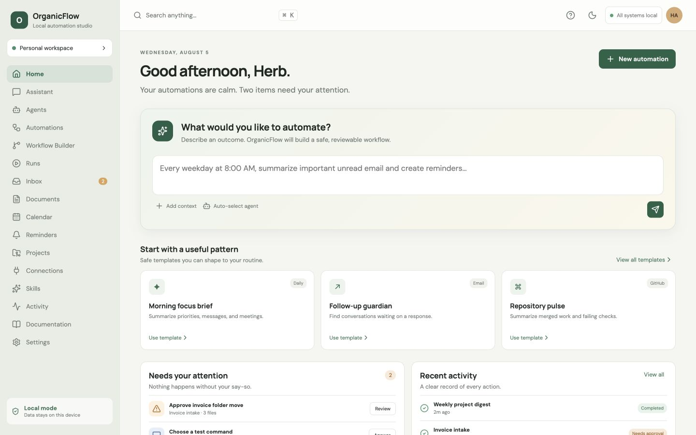

# OrganicFlow

> A local-first command center for safe, reviewable AI automation.

OrganicFlow is an open-source automation studio that turns plain-language outcomes into inspectable workflows. This initial release implements a polished responsive dashboard, visual email-summary workflow, deterministic mock simulation API, Codex detection, contextual help, and backend-enforced high-impact approvals.



## Project status

- **Implemented:** web dashboard and workflow builder, light/dark themes, responsive navigation, local FastAPI service, Codex detection, workflow draft/simulation endpoints, versioned JSON Schema, approval enforcement, mock email/reminders, help panel.
- **Experimental:** local Codex provider design and run model.
- **Planned:** live provider adapters, persistence/worker services, Tauri desktop packaging, full node editor, scheduling, and production Docker stack.

## Quick start

```bash
npm install
npm run dev
```

Open <http://127.0.0.1:5173>. Start the API separately:

```bash
python3 -m venv .venv
.venv/bin/pip install -r apps/api/requirements.txt
.venv/bin/uvicorn apps.api.main:app --reload --port 8000
```

Run checks with `npm test`, `npm run typecheck`, `npm run build`, and `.venv/bin/pytest` (after installing pytest/httpx). API docs are available at <http://127.0.0.1:8000/docs>.

## Safety model

All external content is untrusted. Workflows begin disabled, mock simulation cannot contact real accounts, local files are never silently sent to a provider, and high-impact operations are rejected by the API without explicit approval. See [the threat model](docs/security/threat-model.md).

## Architecture

The TypeScript web app consumes a local FastAPI service. A versioned workflow schema is the contract between visual editing and execution. Provider, plugin, database, queue, and desktop layers remain replaceable boundaries; see [ADR 0001](docs/architecture/0001-local-first.md).

## Codex

The `/api/codex` endpoint detects `codex` from `PATH` without assuming a location and reports the supported safety modes. No API key is required for detection or demo mode.

Apache-2.0 licensed. Contributions are welcome through the guidance in [CONTRIBUTING.md](CONTRIBUTING.md); report vulnerabilities according to [SECURITY.md](SECURITY.md).
